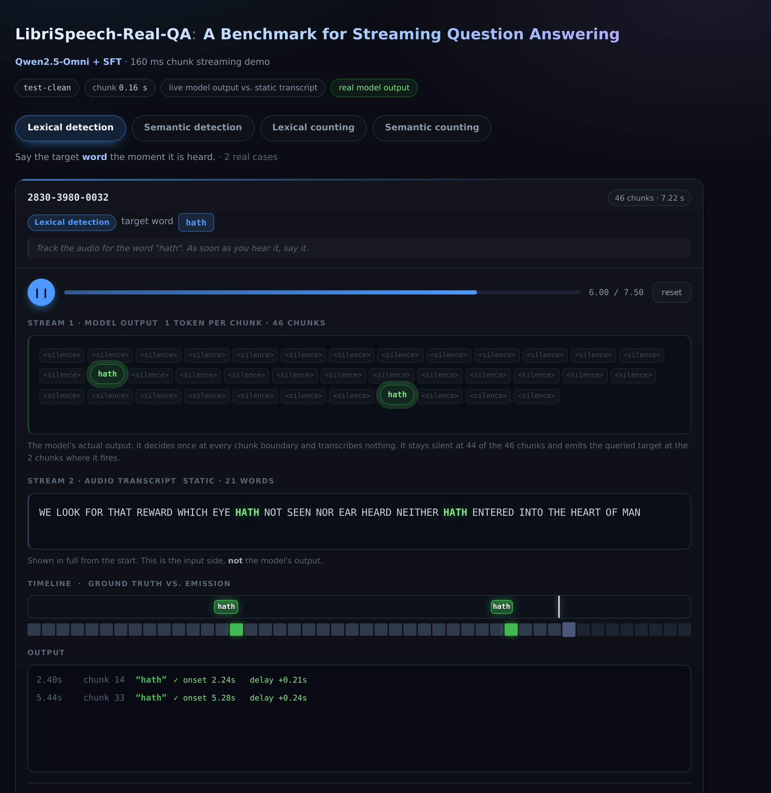

# LibriSpeech-Real-QA · Project Page

The project page and interactive streaming demo for **LibriSpeech-Real-QA**, a
benchmark for *streaming question answering* over continuous speech.

A Qwen2.5-Omni-7B model, adapted with LoRA SFT, listens to a LibriSpeech utterance
in **160 ms chunks** and makes one decision per chunk: stay silent, or emit the
queried content the moment it becomes observable.

▶ **Project page:** https://zxzxz-1.github.io/librispeech-real-qa-demo/

▶ **Interactive demo:** https://zxzxz-1.github.io/librispeech-real-qa-demo/demo/

- [Paper](https://arxiv.org/abs/2611.06496)
- [Dataset](https://huggingface.co/datasets/light1726/librispeech-realtime-qa)
- [Code](https://github.com/zxzxz-1/librispeech-real-qa-demo)



---

## What this shows

Eight hand-picked cases from `test-clean` — two per task, all with perfect
detection (F1 = 1.0, no false alarms):

| Task | Query | What the model must do |
|---|---|---|
| Lexical detection | `hath`, `shiver` | say the target **word** as soon as it is heard |
| Semantic detection | `food`, `color` | say any word of the target **category** as soon as it is heard |
| Lexical counting | `thy`, `i've` | keep a running tally, say the updated count |
| Semantic counting | `weather`, `body_part` | keep a running tally of a **category**, say the updated count |

Every audio clip and every model output is the **real** prediction on `test-clean`.
Nothing is hand-written, scripted, or simulated.

## How to read the display

Two streams are shown: the model's **live** per-chunk output first, then a **static**
reference transcript.

**Stream 1 — model output.** One token per chunk, because the model decides exactly
once at every chunk boundary. It transcribes nothing.

- **`<silence>`** = the model emits nothing at that chunk boundary
- <span>**green chip**</span> = the model commits the queried content at that chunk

The output is dominated by silence: across the eight cases, 2–3 chunks out of 27–47
carry an emission and all the rest are `<silence>`. That sparsity is the point — a
streaming model has to learn *when not to speak* as much as *when to speak*.

**Stream 2 — audio transcript (static).** The full sentence, shown in full from the
start. Word timings come from forced alignment, but nothing about the transcript is
streamed: it is a fixed reference you can read ahead of the audio. This is the *input*
side, not the model's output.

- <span>**purple**</span> = the queried target word
- <span>**green**</span> = the model has responded to that word

Also shown:

- **Timeline** — ground-truth event spans, lit green when the model's emission matches.
- **Chunk strip** — one cell per 160 ms chunk; green marks a chunk that fired.
- **Output log** — the raw per-chunk decisions with onset and delay.

## Timing convention

Chunk *k* covers `[k·0.16, (k+1)·0.16)` s and is fully consumed at `(k+1)·0.16` s —
the earliest instant the model can possibly answer. Outputs are therefore shown at
`(k+1)·0.16` s, which is the wall-clock latency of a real streaming system.

The evaluation metric instead scores the chunk's *onset* `k·0.16` s against the
ground-truth window `[t_start, t_end]`, so the reported `delay` is measured from the
word's onset.

## Files

| File | Purpose |
|---|---|
| `index.html` | the research project page |
| `assets/style.css` | project page styles |
| `assets/preview.png` | project page and README demo preview |
| `demo/index.html` | the demo — fully self-contained (audio is base64-embedded), no external requests |
| `build_streaming_demo.py` | regenerates `demo/index.html` from inference logs |
| `align_words.py` | forced alignment of LibriSpeech transcripts with wav2vec2 |
| `word_align.json` | word-level timings produced by `align_words.py` |
| `test_demo.js` | headless functional test (DOM + Audio stubbed) |
| `render_transcript.js` | prints both rendered streams to the console for inspection |
| `make_preview.py` | regenerates `assets/preview.png` with Playwright |

## Running the test

```bash
node test_demo.js
```

Drives the player through every card and asserts that the transcript stays static
throughout playback, that the output stream has exactly one token per chunk with
emissions only at the chunks the model fired on, that the output stays dominated by
`<silence>`, and that reset clears all state.

It uses `demo/index.html` by default and honours `DEMO_HTML=<file>`.

## Rebuilding

`build_streaming_demo.py` and `align_words.py` read inference logs and audio from a
local LibriSpeech checkout, so they need those paths — see the constants at the top of
each file. `demo/index.html` is committed, so the demo itself needs no rebuild to be viewed.

## Attribution

- Audio: [LibriSpeech](https://www.openslr.org/12) (Panayotov et al., ICASSP 2015), CC BY 4.0
- Forced alignment: `WAV2VEC2_ASR_BASE_960H` via `torchaudio`
- Base model: [Qwen2.5-Omni-7B](https://github.com/QwenLM/Qwen2.5-Omni)
